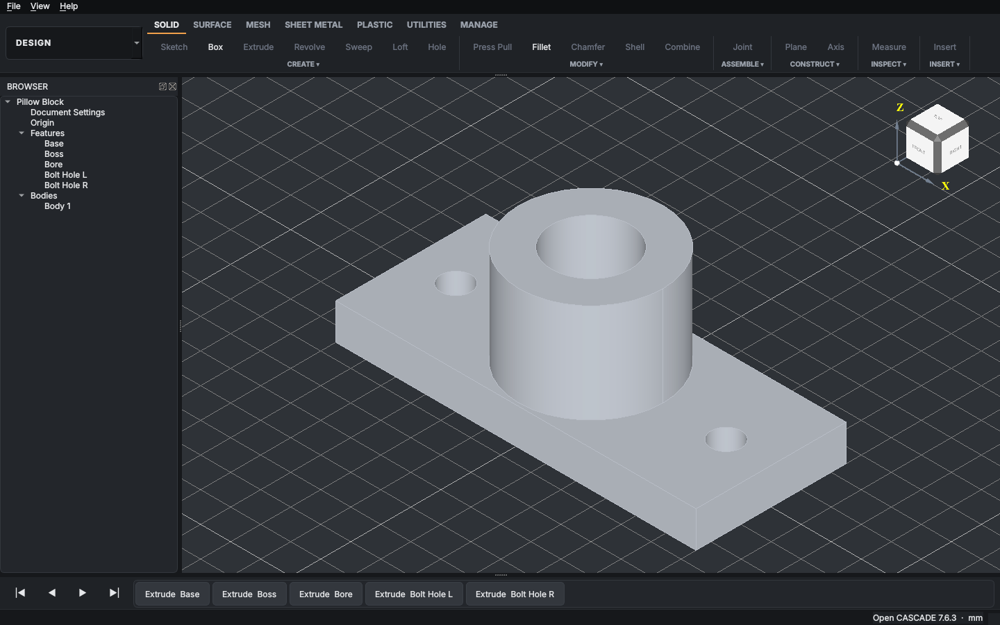

# BrazenWorks

**Open-source CAD/CAM for design and machining.**

BrazenWorks is a free, open-source parametric CAD/CAM application with a familiar
workspace layout: a workspace switcher and tool ribbon across the top, a browser tree
on the left, the 3D viewport with a view cube in the centre, and a feature timeline
along the bottom. One app covers design (sketch, model, assemble) and manufacturing
(setups, toolpaths, simulation, post-processing).



> **Status: early development (milestone M0).** The app shell, Open CASCADE viewport,
> and a parametric timeline with extrude/cut/fillet work. It is not usable for real
> work yet. See [docs/ROADMAP.md](docs/ROADMAP.md).

## Tech stack

| Layer | Language | What it does |
|---|---|---|
| `src/app` | C++20 + Qt 6 | Desktop UI: ribbon, browser, viewport, timeline |
| `src/geometry` | C++20 | Thin facade over [Open CASCADE Technology](https://dev.opencascade.org) (B-rep kernel) |
| `src/bridge` | C++ ⇄ Rust | [CXX](https://cxx.rs) bridge between the model and the kernel |
| `crates/model_core` | Rust | Document model and feature timeline (later: sketch solver, CAM logic) |

Why this split: OCCT and Qt are C++, so the UI and kernel wrapper stay in C++ with
no translation layer. The model logic, where most of the tricky state lives, is in
Rust. See [docs/ARCHITECTURE.md](docs/ARCHITECTURE.md).

## Building

Each platform has a one-time setup script in `tools/dev-env/`. It installs the
dependencies and writes `CMakeUserPresets.json`, so building is the same three
commands everywhere: configure, build, test with the `dev` preset
(RelWithDebInfo; use `release` for an optimized build).

### Windows

Requirements: Visual Studio 2022 or newer with the *Desktop development with C++*
workload. `setup-windows.ps1` installs Git, CMake, Ninja, Python and Rust (via
winget, if missing), Open CASCADE (via vcpkg, compiled once, 30–60 min) and Qt 6
(via aqtinstall, prebuilt). It also writes `CMakeUserPresets.json`. Run it from an
**administrator** PowerShell. `msvc.cmd` runs a command inside the MSVC
environment with Qt on `PATH`:

```bat
powershell -ExecutionPolicy Bypass -File tools\dev-env\setup-windows.ps1
tools\dev-env\msvc.cmd cmake --preset dev
tools\dev-env\msvc.cmd cmake --build --preset dev
tools\dev-env\msvc.cmd ctest --preset dev
tools\dev-env\msvc.cmd build\dev\brazenworks.exe
```

Options: `-VcpkgRoot` (default `C:\vcpkg`, keep it short), `-QtRoot` (default
`C:\Qt`), `-QtVersion` (default `6.8.3`). The script is safe to re-run. Each build
copies Qt next to the exe (windeployqt), so `build\dev\brazenworks.exe` also starts
with a double-click. The app
needs OpenGL 2.1 or newer, which any GPU from the last decade has.

### Linux (Ubuntu 24.04 / Debian)

```bash
tools/dev-env/setup-linux.sh          # apt packages + Rust + presets
cmake --preset dev
cmake --build --preset dev
ctest --preset dev
./build/dev/brazenworks
```

### macOS

```bash
tools/dev-env/setup-macos.sh          # Homebrew packages + Rust + presets
cmake --preset dev
cmake --build --preset dev
ctest --preset dev
open build/dev/brazenworks.app
```

### Rust-only tests

The model crate's tests run without Qt or OCCT, against a mock kernel:

```bash
cargo test --manifest-path crates/model_core/Cargo.toml
```

## Viewport controls

| Action | Input |
|---|---|
| Pan | Middle-drag |
| Orbit | Shift + middle-drag |
| Zoom | Mouse wheel |
| Select (window) | Left-drag |
| Fit all | F6, or the nav bar at the bottom of the view |

The nav bar also has a home view, orbit/pan/zoom modes for left-drag, display modes
(shaded, shaded with edges, wireframe) and a grid toggle.

## Renaming the product

The product name lives in **one file: [`branding.json`](branding.json)**. CMake reads it
and generates `Branding.h`, the executable name, the macOS bundle name and the Linux
desktop entry. No source file contains the name. To rename everything, including
this README:

```bash
python3 tools/rename.py --name "New Name" --dry-run   # preview
python3 tools/rename.py --name "New Name"
rm -rf build && cmake -S . -B build -G Ninja && cmake --build build
```

## Contributing

Contributions are welcome. Please read [CONTRIBUTING.md](CONTRIBUTING.md) first,
especially the rules on reusing code from other projects.

## License

BrazenWorks is released under the [MIT License](LICENSE). It links to Open CASCADE
(LGPL-2.1 with exception) and Qt (LGPL-3.0) dynamically; see
[THIRD_PARTY_NOTICES.md](THIRD_PARTY_NOTICES.md).

BrazenWorks is an independent project. It is not affiliated with, endorsed by or
sponsored by Autodesk, Inc. All trademarks belong to their owners.
